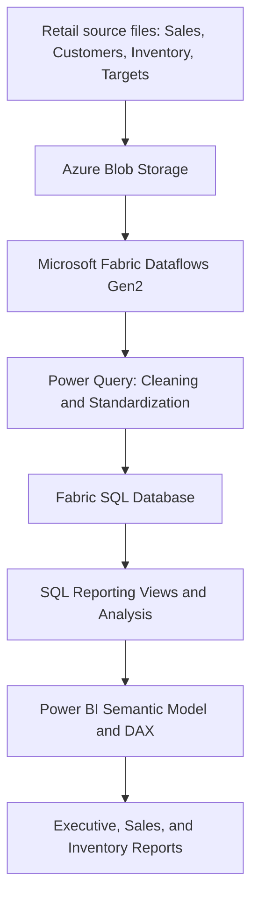

# Retail Sales & Inventory Analytics | Microsoft Fabric + Power BI

**End-to-end retail analytics portfolio project** integrating cloud-hosted retail data, Power Query transformations, SQL-based analysis, and interactive Power BI reporting.

**Tech stack:** Microsoft Fabric · Dataflows Gen2 · Power Query (M) · Azure Blob Storage · Fabric SQL Database · SQL · Power BI · DAX

## Project overview

This project explores retail sales, profitability, customer purchasing patterns, product performance, sales targets, and inventory levels. The objective is to turn disparate retail datasets into a consistent reporting layer and make operational and financial performance easier to analyze.

The solution combines data preparation in Microsoft Fabric, SQL-based reporting, and Power BI dashboards for executive-level monitoring and detailed analysis.

> **Portfolio note:** Dashboard images below are from the project. Metrics shown are snapshots of the report, not independently verified business outcomes. This repository describes the implemented workflow; update any implementation details if your final environment differs.

## Dashboard gallery

### 1. Executive sales overview


**Purpose:** Provide a high-level view of sales, profitability, units sold, inventory value, and sales performance relative to targets.

**Report elements:**
- Current-month total sales, total profits, profit margin percentage, units sold, and inventory value
- Sales-versus-target gauge
- Monthly sales trend and target comparison

**Business questions:** Are sales meeting expectations? How profitable is the current period? How are results changing across months?

### 2. Sales performance & customer insights


**Purpose:** Identify changes in sales performance and compare products, customers, and product categories.

**Report elements:**
- Month-over-month sales percentage change
- Top products by sales
- Top customers by sales
- Revenue and profit-margin scatter plot, segmented by product category

**Business questions:** Which products and customers contribute the most revenue? Which products combine high sales with strong margins? Where are there opportunities to improve performance?

### 3. Inventory summary


**Purpose:** Provide product-level visibility into stock quantities.

**Report elements:**
- Product-level on-hand quantities
- Color-coded quantity indicators for quick scanning

**Business questions:** Which products carry the largest quantities on hand? Which products may warrant further stock-level investigation?

> **Interpretation note:** Quantity-based conditional formatting alone does not prove a product is overstocked or at risk of stockout. Those assessments require additional context such as reorder points, demand, and lead times.

## Data architecture



The architecture separates data ingestion, transformation, SQL analysis, and business-facing reporting. This makes the reporting process easier to maintain and troubleshoot.

## Data sources

| Dataset | Purpose | Example fields |
| --- | --- | --- |
| Customers | Customer attributes and segmentation | CustomerID, CustomerName, Segment, Region, SignupDate |
| Sales | Transaction-level sales analysis | OrderID, OrderDate, CustomerID, Quantity, UnitPrice, DiscountPct, PaymentMethod |
| Inventory | Product availability and inventory analysis | ProductID, ProductName, OnHandQty, UnitCost, ReorderPoint |
| Targets | Sales performance benchmarking | TargetMonth, Region, RevenueTarget |

*Column names are illustrative of the project's working datasets; refer to your final schema for exact names.*

## Data preparation with Power Query

Dataflows Gen2 and Power Query were used to prepare source data before reporting. Transformation scenarios included:

- **Customer standardization:** Cleaned inconsistent customer-name formatting and normalized customer identifiers.
- **Category normalization:** Standardized customer segments, geographic regions, and payment methods.
- **Date handling:** Converted inconsistent date strings into reliable date values for reporting.
- **Numeric conversion:** Handled text-formatted prices, quantities, costs, percentages, and invalid numeric entries.
- **Order ID cleanup:** Standardized order identifier patterns.
- **Data quality:** Investigated null values, duplicates, invalid types, and refresh-time conversion errors.

These transformations support consistent aggregation and reduce downstream reporting errors.

## SQL reporting & analysis

Data was loaded to Fabric SQL Database and queried through SQL reporting views to support analytical reporting. The project focuses on questions such as:

1. How do monthly sales compare with targets?
2. How does revenue change month over month?
3. Which products generate the most sales?
4. Which customers contribute the most revenue?
5. How do revenue and profit margins vary by product or category?
6. What are the on-hand inventory quantities by product?

**SQL concepts demonstrated:** aggregations, joins, CTEs, window functions such as `LAG()`, reporting views, and data-validation queries.

### Example: Month-over-month revenue analysis

The following is an illustrative query pattern; adapt table and column names to the final database schema.

```sql
WITH MonthlySales AS (
    SELECT
        DATEFROMPARTS(YEAR(OrderDate), MONTH(OrderDate), 1) AS SalesMonth,
        SUM(Quantity * UnitPrice) AS Revenue
    FROM dbo.FactSales
    GROUP BY YEAR(OrderDate), MONTH(OrderDate)
),
SalesWithPreviousMonth AS (
    SELECT
        SalesMonth,
        Revenue,
        LAG(Revenue) OVER (ORDER BY SalesMonth) AS PreviousMonthRevenue
    FROM MonthlySales
)
SELECT
    SalesMonth,
    Revenue,
    PreviousMonthRevenue,
    100.0 * (Revenue - PreviousMonthRevenue)
        / NULLIF(PreviousMonthRevenue, 0) AS MoMGrowthPct
FROM SalesWithPreviousMonth
ORDER BY SalesMonth;
```

*Note: Adjust the revenue calculation for discounts, returns, and other business rules when applicable. A production month-over-month comparison should account for missing months in the calendar.*

## Power BI modeling & measures

Power BI provides interactive analysis through a semantic model, DAX calculations, and report visuals. Core metrics include:

| Metric | Business meaning |
| --- | --- |
| Total Sales | Revenue generated in the selected reporting context |
| Total Profit | Sales revenue less the costs included in the profit definition |
| Profit Margin % | Profit relative to sales revenue |
| Sales Target | Planned sales for the selected period |
| Target Achievement % | Actual sales relative to target |
| Units Sold | Total units sold in the selected period |
| Inventory Value | Monetary value of stock on hand |
| MoM Sales Change % | Change in sales compared with the previous month |

### Example DAX measure

```dax
Profit Margin % =
DIVIDE([Total Profit], [Total Sales], 0)
```

The final measures should respect date, product, and regional filters and use consistent revenue and cost definitions.

## Analytical use cases

| Business area | Analysis | Potential decision supported |
| --- | --- | --- |
| Executive performance | Sales, profit, margin, targets | Prioritize performance reviews |
| Sales trends | Monthly revenue and MoM change | Investigate spikes and declines |
| Product performance | Top-selling products | Identify major revenue contributors |
| Customer analysis | Top customers by sales | Understand customer concentration |
| Product profitability | Revenue versus margin | Review pricing and product mix |
| Inventory | On-hand stock by product | Identify products for closer replenishment review |

## Technical challenges addressed

**Inconsistent source values:** Retail data included mixed date formats, text-based numeric values, inconsistent categories, and customer-name variations. Power Query transformations helped normalize these inputs.

**Dataflow refresh errors:** Type conversion failures highlighted the need for defensive parsing, null handling, and validation before loading to a destination.

**Comparing actuals with targets:** Sales transactions and targets can have different reporting grains. Correct comparisons require aligning date and regional context so monthly targets are not multiplied by transaction-level joins.

**Communicating analytical findings:** The report separates executive monitoring from detailed product, customer, and inventory analysis to make the dashboards easier to navigate.

## Repository structure

```text
retail-analytics/
├── README.md
└── images/
    ├── executive-sales-overview.png
    ├── sales-detail.png
    └── inventory-summary.png
```

**Recommended future additions:**

```text
├── power-query/          # Sanitized Power Query M scripts
├── sql/                  # Reporting views and analysis queries
├── power-bi/             # Shareable PBIX or PBIP files
└── docs/                 # Data dictionary and model diagram
```

These additional folders are suggestions, not claims that their files are already included.

## How to explore this project

1. Review the architecture to understand the data flow.
2. Browse the dashboard screenshots for the business questions covered.
3. Review the SQL and Power Query artifacts when added to the repository.
4. Explore the Power BI report file or public report link if a shareable version is published.

## Skills demonstrated

`Data Cleaning` · `ETL / ELT` · `Power Query M` · `Microsoft Fabric` · `Azure Blob Storage` · `SQL` · `Data Validation` · `Analytical Reporting` · `Power BI` · `DAX` · `Business Intelligence` · `Data Visualization`

---

**Project type:** Data Analyst / Business Intelligence portfolio project  
**Focus:** Retail sales, profitability, customer behavior, targets, and inventory reporting

